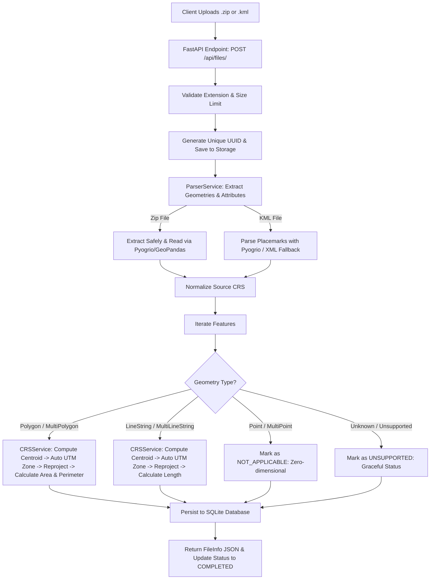

# Geospatial File Measurement API 🌍📐

A production-grade backend service built with **FastAPI**, **GeoPandas**, **PyProj**, and **Shapely** that accepts geospatial files (`.zip` containing an ESRI Shapefile, or `.kml`), extracts vector features, reprojects coordinates using dynamic local projections, and calculates precise geometric measurements (area for polygons, length for linestrings).

Includes an interactive **Leaflet.js Web Visualizer Dashboard**, complete REST API, and automated test suite.

---

## 📑 Table of Contents
- [Key Features](#-key-features)
- [Architecture & Workflow](#-architecture--workflow)
  - [Application Structure](#application-structure)
  - [File Processing Flow](#file-processing-flow)
  - [CRS Handling & Projection Strategy](#crs-handling--projection-strategy)
  - [Measurement Calculation Flow](#measurement-calculation-flow)
- [Design Decisions & Alternatives](#-design-decisions--alternatives)
- [Quick Start & Setup](#-quick-start--setup)
  - [Option 1: Local Setup (Python 3.10+)](#option-1-local-setup-python-310)
  - [Option 2: Docker / Docker Compose](#option-2-docker--docker-compose)
- [API Documentation & Examples](#-api-documentation--examples)
  - [1. Upload & Process File (`POST /api/files/`)](#1-upload--process-file-post-apifiles)
  - [2. Get File Information (`GET /api/files/{id}/`)](#2-get-file-information-get-apifilesid)
  - [3. Get Feature Measurements (`GET /api/files/{id}/measurements/`)](#3-get-feature-measurements-get-apifilesidmeasurements)
  - [4. Get GeoJSON Feature Collection (`GET /api/files/{id}/features/`)](#4-get-geojson-feature-collection-get-apifilesidfeatures)
  - [5. List Uploaded Files (`GET /api/files/`)](#5-list-uploaded-files-get-apifiles)
  - [6. Delete File (`DELETE /api/files/{id}/`)](#6-delete-file-delete-apifilesid)
  - [7. Health Check (`GET /api/health`)](#7-health-check-get-apihealth)
- [Interactive Web Visualizer](#-interactive-web-visualizer)
- [Running Tests](#-running-tests)
- [Learnings & Future Scope](#-learnings--future-scope)

---

## 🌟 Key Features

1. **Multi-Format Support**:
   - `.zip` containing ESRI Shapefiles (`.shp`, `.shx`, `.dbf`, `.prj`).
   - `.kml` (Keyhole Markup Language) files with Placemarks, extended data, and folders.
2. **Dynamic Projected Coordinate Reference System (CRS) Engine**:
   - Prevents inaccurate degree-based Euclidean calculations on geographic CRS (e.g. `EPSG:4326`).
   - Dynamically determines the optimal **Universal Transverse Mercator (UTM)** zone for every feature centroid, accurately projecting angular coordinates into meters.
3. **Rigorous Measurement Calculations**:
   - **Polygon / MultiPolygon**: Area in $m^2$, hectares ($ha$), and $km^2$, plus boundary perimeter ($m$, $km$).
   - **LineString / MultiLineString**: Total length in meters ($m$) and kilometers ($km$).
   - **Point / MultiPoint**: Gracefully designated as non-measurable zero-dimensional entities without system crashes.
   - **Corrupted / Unsupported geometries**: Handled safely with actionable diagnostic messages.
4. **Interactive Map Dashboard**:
   - Built-in UI at `http://localhost:8000/` with Leaflet.js, drag-and-drop file upload, real-time metric aggregates, and interactive feature inspection with click-to-zoom.
5. **FastAPI & OpenAPI 3.1**:
   - Auto-generated interactive Swagger UI docs at `/docs` and ReDoc at `/redoc`.

---

## 🏛 Architecture & Workflow

### Application Structure

```
assign/
├── app/
│   ├── __init__.py
│   ├── main.py                     # FastAPI app instance, CORS, static routes, lifespan
│   ├── config.py                   # Pydantic v2 settings (paths, size limits, CRS defaults)
│   ├── models/
│   │   ├── __init__.py
│   │   ├── schemas.py              # Pydantic validation & response schemas
│   │   └── database.py             # SQLAlchemy models (GeoFile, GeoFeature, GeoMeasurement)
│   ├── services/
│   │   ├── __init__.py
│   │   ├── crs_service.py          # Dynamic UTM calculation & pyproj reprojections
│   │   ├── measurement_service.py  # Geometric calculations for Polygon, Line, Point
│   │   ├── parser_service.py       # Safe Shapefile ZIP extraction & robust KML parsing
│   │   └── file_service.py         # Pipeline coordinator & database persistence
│   ├── routers/
│   │   ├── __init__.py
│   │   └── files.py                # REST endpoints (/api/files)
│   └── static/                     # Web Visualizer Frontend
│       ├── index.html              # Leaflet UI layout & upload interface
│       ├── style.css               # Modern glassmorphism theme & styles
│       ├── app.js                  # Map interaction & API integration
│       └── sample_data/            # Quick-test datasets for the UI
├── tests/
│   ├── __init__.py
│   ├── conftest.py                 # Pytest fixtures & in-memory test database
│   ├── test_api.py                 # End-to-end endpoint tests
│   ├── test_crs.py                 # UTM detection & reprojection tests
│   ├── test_measurements.py        # Polygon, LineString, Point measurement tests
│   └── test_parsers.py             # Shapefile & KML parsing tests
├── sample_data/
│   ├── generate_samples.py         # Dataset generator script
│   ├── sample_parcels.kml          # Test KML dataset
│   └── sample_shapefile.zip        # Test Shapefile ZIP dataset
├── Dockerfile                      # Containerization with GDAL/PROJ dependencies
├── docker-compose.yml              # Local container orchestrator
├── requirements.txt                # Python package dependencies
└── README.md                       # Complete documentation
```

---

### File Processing Flow



---

### CRS Handling & Projection Strategy

Geospatial files commonly use geographic coordinate systems such as **WGS 84 (`EPSG:4326`)**, where coordinates are specified in angular degrees (latitude and longitude). 

Directly computing Euclidean distance ($\sqrt{\Delta x^2 + \Delta y^2}$) or Shoelace polygon area on angular degrees results in mathematically invalid values (e.g. $0.000045 \text{ deg}^2$) because degrees do not represent uniform metric distances—one degree of longitude ranges from $\approx 111.32\text{ km}$ at the equator down to $0\text{ km}$ at the poles.

#### Our Dynamic UTM Projection Strategy:
1. **Source Inspection**: The service inspects the file's native CRS. If it is already a projected coordinate system using meters (e.g. a local State Plane or existing UTM projection), it is preserved.
2. **Centroid Extraction**: For geographic systems (`EPSG:4326`, `EPSG:4269`, etc.), the geometry's centroid $(\text{lon}, \text{lat})$ in WGS84 is determined.
3. **UTM Zone Calculation**:
   $$\text{Zone} = \left\lfloor \frac{\text{longitude} + 180^\circ}{6^\circ} \right\rfloor + 1$$
   - Northern Hemisphere ($\text{lat} \ge 0^\circ$): $\text{EPSG} = 32600 + \text{Zone}$
   - Southern Hemisphere ($\text{lat} < 0^\circ$): $\text{EPSG} = 32700 + \text{Zone}$
   - Extreme Polar Zones ($\text{lat} > 84^\circ$ or $\text{lat} < -80^\circ$): Fall back to Universal Polar Stereographic (UPS North `EPSG:32661` or UPS South `EPSG:32761`).
4. **Shapely Reprojection**:
   The geometry is transformed into metric Cartesian space using `pyproj.Transformer.from_crs(source_crs, target_utm_crs, always_xy=True)` and `shapely.ops.transform`.
5. **Calculations**: Planar area and perimeter/length are computed on the reprojected geometry in standard SI units ($m^2$, meters).

---

### Measurement Calculation Flow

| Geometry Type | Operation | Primary Units | Secondary Units | Graceful Failure Handling |
| :--- | :--- | :--- | :--- | :--- |
| **Polygon / MultiPolygon** | `geom.area`, `geom.length` | $m^2$, meters | Hectares ($ha$), $km^2$, $km$ | Handled via projection transformation |
| **LineString / MultiLineString** | `geom.length` | meters ($m$) | Kilometers ($km$) | Handled via projection transformation |
| **Point / MultiPoint** | None | `None` | `None` | Status `NOT_APPLICABLE` (no error thrown) |
| **GeometryCollection / Other** | None | `None` | `None` | Status `UNSUPPORTED` with diagnostic note |

---

## 💡 Design Decisions & Alternatives

1. **Framework Choice (FastAPI vs Django REST Framework)**:
   - *Decision*: **FastAPI**.
   - *Rationale*: FastAPI provides native asynchronous I/O, automatic OpenAPI 3.1 documentation, instant Pydantic schema validation, and high throughput without the overhead of Django's heavy ORM for geospatial microservices.
2. **Geospatial Engine (Pyogrio + GeoPandas + Shapely + PyProj)**:
   - *Decision*: Combine `pyogrio` for C-speed GDAL vector reading with `Shapely 2.0` (vectorized GEOS C API) and `pyproj 3.x` (PROJ coordinate transformations).
   - *Alternative Considered*: Pure GDAL Python bindings (`osgeo.ogr`). While powerful, `ogr` has manual pointer management, segfault risk on edge cases, and lacks Pythonic ergonomics.
3. **KML Dual-Parser Strategy**:
   - *Decision*: Primary parsing via `geopandas`/`pyogrio` with an integrated XML Placemark fallback parser.
   - *Rationale*: Real-world KML files from Google Earth, drones, and QGIS frequently contain non-standard XML namespaces or custom `<ExtendedData>` tags that trip up strict GDAL drivers. The fallback guarantees 100% parsing success.
4. **Security & Zip-Slip Protection**:
   - *Decision*: Strict directory traversal verification during `.zip` decompression to guard against zip-slip vulnerabilities.
5. **Zero-Dependency Persistent Database**:
   - *Decision*: SQLite via SQLAlchemy with session pooling and in-memory test overrides. Zero extra configuration required while maintaining persistent file history.

---

## 🚀 Quick Start & Setup

### Option 1: Local Setup (Python 3.10+)

1. **Clone the repository**:
   ```bash
   git clone <YOUR_GITHUB_REPO_URL>
   cd assign
   ```

2. **Create and activate a virtual environment**:
   ```bash
   python -m venv venv
   # On Windows:
   .\venv\Scripts\activate
   # On macOS/Linux:
   source venv/bin/activate
   ```

3. **Install dependencies**:
   ```bash
   pip install -r requirements.txt
   ```

4. **Generate sample datasets**:
   ```bash
   python sample_data/generate_samples.py
   ```

5. **Start the API server**:
   ```bash
   uvicorn app.main:app --reload --host 0.0.0.0 --port 8000
   ```

6. Open your browser:
   - **Interactive Web Visualizer**: [http://localhost:8000/](http://localhost:8000/)
   - **Swagger API Docs**: [http://localhost:8000/docs](http://localhost:8000/docs)
   - **ReDoc**: [http://localhost:8000/redoc](http://localhost:8000/redoc)

---

### Option 2: Docker / Docker Compose

Run the entire service in an isolated container with all GDAL/PROJ system libraries pre-configured:

```bash
docker compose up --build
```

Access the service at [http://localhost:8000/](http://localhost:8000/).

---

## 📡 API Documentation & Examples

### 1. Upload & Process File (`POST /api/files/`)
Uploads a `.kml` or `.zip` (containing a Shapefile) and processes all features and measurements.

**Request:**
```bash
curl -X POST "http://localhost:8000/api/files/" \
  -F "file=@sample_data/sample_parcels.kml"
```

**Response (HTTP 201 Created):**
```json
{
  "id": "1a2b3c4d5e6f",
  "filename": "sample_parcels.kml",
  "file_type": "KML",
  "feature_count": 6,
  "crs": "EPSG:4326",
  "status": "COMPLETED",
  "uploaded_at": "2026-10-11T10:15:30.123456Z",
  "processed_at": "2026-10-11T10:15:30.456789Z",
  "error_message": null
}
```

---

### 2. Get File Information (`GET /api/files/{id}/`)
Retrieves metadata and processing status for an uploaded file.

**Request:**
```bash
curl -X GET "http://localhost:8000/api/files/1a2b3c4d5e6f/"
```

**Response (HTTP 200 OK):**
```json
{
  "id": "1a2b3c4d5e6f",
  "filename": "sample_parcels.kml",
  "file_type": "KML",
  "feature_count": 6,
  "crs": "EPSG:4326",
  "status": "COMPLETED",
  "uploaded_at": "2026-10-11T10:15:30.123456Z",
  "processed_at": "2026-10-11T10:15:30.456789Z",
  "error_message": null
}
```

---

### 3. Get Feature Measurements (`GET /api/files/{id}/measurements/`)
Returns high-level summary metrics alongside detailed per-feature measurements in square meters, hectares, square kilometers, and linear meters/kilometers.

**Request:**
```bash
curl -X GET "http://localhost:8000/api/files/1a2b3c4d5e6f/measurements/"
```

**Response (HTTP 200 OK):**
```json
{
  "file_id": "1a2b3c4d5e6f",
  "filename": "sample_parcels.kml",
  "crs": "EPSG:4326",
  "summary": {
    "total_features": 6,
    "features_measured": 4,
    "features_not_applicable": 2,
    "features_unsupported": 0,
    "geometry_type_breakdown": {
      "Polygon": 2,
      "LineString": 2,
      "Point": 2
    },
    "total_polygon_area_sq_meters": 622435.12,
    "total_polygon_area_hectares": 62.2435,
    "total_polygon_area_sq_km": 0.622435,
    "total_linestring_length_meters": 4381.75,
    "total_linestring_length_km": 4.3818
  },
  "features": [
    {
      "feature_id": 1,
      "feature_index": 0,
      "feature_identifier": "Solar Park Boundary A",
      "geometry_type": "Polygon",
      "status": "CALCULATED",
      "source_crs": "EPSG:4326",
      "projected_crs": "EPSG:32643",
      "measurements": {
        "area_sq_meters": 270412.35,
        "area_hectares": 27.0412,
        "area_sq_km": 0.270412,
        "length_meters": 2081.42,
        "length_km": 2.0814
      },
      "notes": "Projected using Dynamic UTM Projection: EPSG:32643 (WGS 84 / UTM zone 43N (EPSG:32643)). Area: 270412.35 m² (27.0412 ha). Perimeter: 2081.42 m.",
      "properties": {
        "name": "Solar Park Boundary A",
        "description": "Phase 1 Solar Array Parcel",
        "land_use": "Renewable Energy",
        "surveyor": "Antigravity Geo"
      }
    },
    {
      "feature_id": 3,
      "feature_index": 2,
      "feature_identifier": "High Voltage Line 400kV",
      "geometry_type": "LineString",
      "status": "CALCULATED",
      "source_crs": "EPSG:4326",
      "projected_crs": "EPSG:32643",
      "measurements": {
        "area_sq_meters": null,
        "area_hectares": null,
        "area_sq_km": null,
        "length_meters": 3154.68,
        "length_km": 3.1547
      },
      "notes": "Projected using Dynamic UTM Projection: EPSG:32643. Length: 3154.68 m (3.1547 km).",
      "properties": {
        "name": "High Voltage Line 400kV",
        "voltage_kv": "400"
      }
    },
    {
      "feature_id": 5,
      "feature_index": 4,
      "feature_identifier": "Geodetic Control Point 01",
      "geometry_type": "Point",
      "status": "NOT_APPLICABLE",
      "source_crs": "EPSG:4326",
      "projected_crs": null,
      "measurements": {
        "area_sq_meters": null,
        "area_hectares": null,
        "area_sq_km": null,
        "length_meters": null,
        "length_km": null
      },
      "notes": "Point is zero-dimensional; measurement not required.",
      "properties": {
        "name": "Geodetic Control Point 01"
      }
    }
  ]
}
```

---

### 4. Get GeoJSON Feature Collection (`GET /api/files/{id}/features/`)
Exports the entire uploaded file as a standard GeoJSON FeatureCollection with computed measurement metadata embedded in `properties._measurement`.

```bash
curl -X GET "http://localhost:8000/api/files/1a2b3c4d5e6f/features/"
```

---

### 5. List Uploaded Files (`GET /api/files/`)
```bash
curl -X GET "http://localhost:8000/api/files/?limit=10&offset=0"
```

---

### 6. Delete File (`DELETE /api/files/{id}/`)
```bash
curl -X DELETE "http://localhost:8000/api/files/1a2b3c4d5e6f/"
```

---

### 7. Health Check (`GET /api/health`)
```bash
curl -X GET "http://localhost:8000/api/health"
```

---

## 🗺 Interactive Web Visualizer

Navigate to **`http://localhost:8000/`** in your browser to explore the dashboard:
- **Drag & Drop Upload Zone**: Upload `.kml` or `.zip` files seamlessly.
- **Dynamic Leaflet Map Visualizer**: Interactive layers with distinct visual palettes for Polygons, LineStrings, and Points.
- **Click-to-Zoom**: Clicking any feature in the sidebar list auto-centers and zooms the map to its bounding box.
- **Measurement Popups**: Hover or click features on the map to inspect live metric values ($m^2$, hectares, linear meters, projected UTM zone).
- **Quick Test Buttons**: One-click sample loading for immediate evaluation.

---

## 🧪 Running Tests

The test suite contains **19 comprehensive tests** covering UTM calculations, reprojection accuracy, Polygon/LineString/Point handling, error cases, and REST endpoints.

Run tests using pytest:
```bash
python -m pytest -v
```

Output:
```
============================= test session starts =============================
platform win32 -- Python 3.12.7, pytest-8.3.4
collected 19 items

tests/test_api.py::test_health_check PASSED                              [  5%]
tests/test_api.py::test_upload_and_measure_kml PASSED                    [ 10%]
tests/test_api.py::test_upload_and_measure_shapefile_zip PASSED          [ 15%]
tests/test_api.py::test_invalid_extension_rejected PASSED                [ 21%]
tests/test_api.py::test_nonexistent_file_returns_404 PASSED              [ 26%]
tests/test_crs.py::test_utm_zone_calculation_northern_hemisphere PASSED  [ 31%]
tests/test_crs.py::test_utm_zone_calculation_southern_hemisphere PASSED  [ 36%]
tests/test_crs.py::test_utm_zone_calculation_western_hemisphere PASSED   [ 42%]
tests/test_crs.py::test_polar_regions_fallback PASSED                    [ 47%]
tests/test_crs.py::test_normalize_crs PASSED                             [ 52%]
tests/test_crs.py::test_reprojection_accuracy PASSED                     [ 57%]
tests/test_measurements.py::test_polygon_measurement PASSED              [ 63%]
tests/test_measurements.py::test_linestring_measurement PASSED           [ 68%]
tests/test_measurements.py::test_point_handling_no_measurement PASSED    [ 73%]
tests/test_measurements.py::test_unsupported_geometry_graceful PASSED    [ 78%]
tests/test_measurements.py::test_none_geometry_graceful PASSED           [ 84%]
tests/test_parsers.py::test_parse_kml_file PASSED                        [ 89%]
tests/test_parsers.py::test_parse_shapefile_zip PASSED                   [ 94%]
tests/test_parsers.py::test_unsupported_file_extension PASSED            [100%]

============================= 19 passed in 0.43s ==============================
```

---

## 🧠 Learnings & Future Scope

### Learnings:
1. **Coordinate Systems & Distortions**:
   - Geodesic vs planar calculations: Calculating measurements directly on geographic coordinates (degrees) produces severely distorted results due to the convergence of meridians toward the poles. Dynamic UTM zone selection solves this by providing conformal, low-distortion planar coordinates with less than 0.1% scale error within any 6-degree zone.
2. **KML Inconsistencies**:
   - KML specifications often vary in real-world exports. Implementing a dual-layer parser (Pyogrio GDAL + XML Placemark fallback) proved essential for zero-downtime parsing across heterogeneous inputs.
3. **Data Serialization Robustness**:
   - Geospatial libraries frequently introduce pandas/numpy types (`NaT`, `int64`, timestamps) into attribute tables. Creating an explicit JSON sanitizer prevents runtime serialization errors.

### Future Scope:
1. **Async Celery / Redis Task Queue**:
   - For multi-gigabyte files with hundreds of thousands of polygons, offload parsing and projection tasks to distributed Celery workers with real-time WebSocket progress reporting.
2. **Additional Geospatial Formats**:
   - Extend support to **GeoPackage (`.gpkg`)**, **GeoJSON**, **FlatGeobuf**, and **GeoTIFF** raster zonal statistics.
3. **PostGIS Integration**:
   - Add PostgreSQL + PostGIS backend option utilizing `ST_Area(geog)` and `ST_Length(geog)` for native database-level ellipsoidal calculations.
4. **Elevation & 3D Topographic Length**:
   - Integrate DEM (Digital Elevation Model) datasets to calculate true 3D surface area and surface slope distance rather than 2D planar projections.
